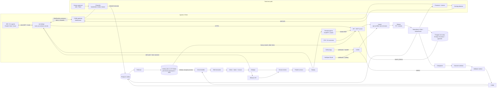

# Master Mind — MVP Implementation Plan

## Context

Master Mind is a company-wide "AI brain" for any team: engineering, marketing, sales, finance, HR. It does three jobs:

1. **Remembers.** A persistence layer (a data lake) keeps a cleaned record of everything people and their AI agents do, plus the results of that work.
2. **Learns.** It decides which tasks worked and turns the proven practices into reusable skills, with evidence. Dexy-style tools need humans to write playbooks; Master Mind generates them from results.
3. **Connects.** Agents can see what other agents are working on in real time, get alerted when their work overlaps, and open a collaboration channel once both humans agree. Example: two developers building different features in the same code.

The lake serves agents both **in real time** (what's happening now) and **afterwards** (what was done before, and what worked).

Constraints: two founders, no funding, a paid pilot in **about 10 weeks**, security and SOC 2-ready from day one, and boring managed tech. The project folder (`/Users/jonathannaor/ai-startup`) is empty, so this is a greenfield build. Step 1 of implementation copies this plan to `docs/PLAN.md`.

---

## 1. Clarifying questions and assumptions

**Answered**
| Question | Answer |
|---|---|
| Which domain(s)? | **Every department.** The core is generic and each department is a config-defined *domain pack*. The MVP ships engineering (GitHub), revenue (HubSpot) and a generic pack. |
| How do agents report work and get skills? | **MCP**, used for capture, deploy and collaboration. |
| Tenant shape | **Single company, many teams.** |
| Stack | **TypeScript + AWS.** |
| Agent collaboration | **In the MVP:** live awareness, overlap alerts, and channels that open only after both humans approve. |
| Timeline | **About 10 weeks**, keeping GitHub, HubSpot, the generic pack and collaboration. |
| Lake format | **Apache Iceberg on Amazon S3 Tables.** |

**Assumed (tell me if any are wrong)**
1. US-only region at first, built GDPR-ready. EU region later.
2. Pilot pricing about $1–3k/month, invoiced by hand. No billing code.
3. No skill reaches anyone without human approval. **No collaboration channel opens without approval from the humans who own the agents involved; agents can never approve for them.**
4. Success thresholds are relative to the team's own baseline, with minimum samples, and admins can edit them.
5. Login through WorkOS (Google/Microsoft plus magic link). SAML/SCIM later.
6. Retention: raw payloads 30 days, cleaned lake data 12 months. Both configurable per tenant.
7. The pilot gives read access to 6–12 months of history for the backtest.
8. Privacy: members can opt out, credit on skills is opt-in, failures are never shown per person, and members can mark a session private (hidden from other agents).
9. Agent capture defaults to **metadata and summaries**: tool names, file paths, intents, and a summary of each step. Full redacted content only if the tenant turns it on.

---

## 2. Scope: MVP vs later

**MVP (weeks 1–10)**
- **Generic core:** Task → Outcome → Judge → Skill → Deploy → Measure, with domain packs as YAML config.
- **Persistence layer:** an Apache Iceberg lake on S3 Tables, with three layers:
  - *bronze:* raw data, encrypted, kept 30 days;
  - *silver:* cleaned agent actions, channel messages and outcomes;
  - *gold:* judged tasks, features and skill usage.
  Recent history is also indexed in Postgres so agents can search it instantly.
- **Agent access:**
  - a remote MCP server for any agent;
  - an **`mm` local bridge** (an npm package) for IDE and CLI agents such as Claude Code and Cursor. The bridge adds automatic capture through hooks plus a real-time WebSocket link.
- **Live awareness:** presence, intents ("what I'm working on"), and an overlap detector covering code files and line ranges, HubSpot objects, and generic resource tags. Alerts go to both agents.
- **Collaboration channels:** a brokered WebSocket channel per collaboration, with a handshake approved by both humans, a scope (who, what resources, what may be shared, how long), every message redacted and scanned, advisory leases on resources, a versioned agreement record, and the transcript stored in the lake.
- **Packs:**
  - Engineering (GitHub App): defects, reverts, CI first-pass, review churn.
  - Revenue (HubSpot): reply, meetings, stage progression, win rate.
  - Generic: metrics defined in the UI, with outcomes from MCP or CSV.
- **Processing:** PII and secret redaction, a rules-based judge, skill generation from contrasting cohorts, verification, de-duplication, and human review.
- **Web app:** library, skill page, review queue, approvals (skills and channels), admin, and audit log.
- **Delivery:** skill versioning and approve/retire/rollback; delivery via MCP, the bridge, Slack notifications and SKILL.md export.
- **Measurement and proof:** used-vs-not-used lift per skill, a degradation flag, the backtest CLI and the backtest report.

**Later (cut)**
- **Connectors:** Google Ads and LinkedIn (apply for API access in week 1); Slack as a *capture* source; Linear, Jira, PagerDuty and Salesforce.
- **Collaboration:** live shared documents between agents (Yjs CRDT); enforcing leases through a GitHub status check; symbol-level overlap detection (tree-sitter); channels between companies (never in the MVP).
- **Delivery:** auto-opening repo PRs with skills.
- **Platform:** SAML/SCIM, EU region, agency hierarchy, fine-grained RBAC, billing, and auto-publish without approval.

---

## 3. System architecture



**Runtime components (ECS Fargate, one image, four entrypoints)**
- `web`: Next.js UI.
- `api`: Fastify. Handles REST, webhooks, OAuth callbacks and the remote MCP server.
- `gateway`: Fastify + `ws`. WebSocket connections for presence, alerts and channels; fan-out across instances through Postgres LISTEN/NOTIFY.
- `worker`: pg-boss pipeline stages, the outbox → Firehose publisher, and the maturity sweeper.

**Two storage tiers, kept deliberately separate**
- **Postgres** holds *current* state: tenants, presence, intents, channels, leases and skills. It also holds a **90-day hot index** of cleaned actions so agent searches answer in milliseconds.
- The **Iceberg lake** holds *all* history, append-only: cleaned actions, channel transcripts, outcomes, judgments and skill usage. It feeds skill cohorts, backtests, analytics and long-range history search.
  - Rows go through a transactional outbox, then Firehose (at-least-once delivery, deduplicated by `event_id`), then Iceberg.

**Real time vs afterwards**
- *Real time:* the bridge reports intents and touched resources, the overlap detector alerts within seconds, and channels let agents coordinate.
- *Afterwards:* `search_history` ("has anyone touched billing proration before? what happened?") answers from the hot index, and from the lake for older items. Skills are learned from the lake.

---

## 4. Data model (Postgres; every table has `tenant_id` + RLS)

**Core (learning loop)**
| Entity | Key fields | Notes |
|---|---|---|
| Tenant, Team, Member | roles (admin, category_owner, member), capture_opt_out, credit_opt_in, visibility_pref | |
| AgentIdentity | kind, api_key_hash, scopes, acting_for_member_id | An agent always belongs to a human. |
| DomainPack, Category, MetricDefinition, JudgeRuleSet | YAML definition, JSON Logic rules, versioned | |
| Connection | provider, scopes, KMS-encrypted token | |
| Task | actor, category, summary_redacted, features, state, **agent_session_id** | |
| Artifact, ExternalRef | redacted content or pointer; `github:pr:…`, `hubspot:email:…` | ExternalRef is the key to attribution. |
| MetricObservation, Judgment | value and n; verdict, lift, confidence interval, ruleset version | |
| Skill, SkillVersion (immutable), SkillEvidence, Review, Deployment, SkillUsage | | as in §5 |
| AuditEvent | hash-chained, append-only | |
| LlmCall | prompt version, model, tokens, cost | |

**Collaboration (new)**
| Entity | Key fields | Notes |
|---|---|---|
| **AgentSession** | agent_identity_id, member_id, context (repo remote, branch, or tool), private flag, status, last_heartbeat | One run of an agent. Presence = heartbeat within the last 60 seconds. |
| **ActionEvent** | session_id, kind (tool_call, edit, command, message, outcome), summary_redacted, resources[], occurred_at, event_id | The cleaned record of an agent action. Hot copy 90 days, then lake only. |
| **ResourceRef** | normalized key: `git:{repo}:{path}[#L10-40]`, `hubspot:list:123`, `tag:{pack}:{name}` | Shared key space for overlap detection and leases. |
| **Intent** | session_id, description_redacted, embedding, resources[], status (active, done, abandoned) | "What I'm working on." |
| **Overlap** | intent_a, intent_b, kind (same_resource, same_lines, related_work), severity, notified_at, resolution | |
| **Channel** | purpose, scope {resources[], share: [intents, summaries, diffs_redacted, messages], ttl}, status (requested, open, closed, expired, rejected), created_by_session | |
| **ChannelParticipant** | channel_id, session_id, member_id, approval (pending, approved, declined), approved_via (web, slack), approved_at | A human approves on behalf of their own agent. |
| **ChannelMessage** | channel_id, seq, from_session, type (intent_update, proposal, interface_change, question, answer, handoff, claim, release), body_redacted, scan_result | Copied to the lake. |
| **Lease** | resource_key, holder_session_id, channel_id, fencing_token (bigserial), expires_at | Advisory in the MVP. |
| **Agreement** | channel_id, version, body (who does what, merge order, interface contract), accepted_by[] | Optimistic concurrency on `version`. |
| **CollabPolicy** | per tenant and per member: allowed scopes, cross-team allowed, pre-approved rules (e.g. "my team, repo X, intents only") | A pre-approval is still a human's agreement, given ahead of time. |

**Lake tables** (Iceberg, one namespace per tenant): `actions`, `channel_messages`, `tasks`, `metric_observations`, `judgments`, `skill_usage`. Partitioned by `event_date` and `source`. Bronze stays as encrypted raw S3 objects with a 30-day lifecycle; agents never read it.

---

## 5. Skill generation

**Key idea: compare groups of tasks, not single wins.** Find what consistently separates successful tasks from similar unsuccessful ones in the same category. This works whether successes are rare (email replies) or failures are rare (PR defects).

**Trigger:** ≥ K=5 new successes in a category (n_total ≥ 20). A single exceptional result also triggers, but its skill is labelled "single-source, low confidence".

**Pipeline**
1. **Cohort builder:** queries the lake's gold tables through Athena. Builds the success set S and a matched baseline/failure set F (same category, period, size and audience), then clusters S by embedding.
2. **Feature hints:** the pack defines structured features (PR size, tests touched, reviewers, agent-authored, *whether a collaboration channel was used*; email length, personalization, CTA, send time). The differences between S and F go to the LLM as hints.
3. **Contrastive extraction:** Claude Sonnet via Bedrock, with a JSON-schema tool output. Produces a `SkillDraft` with title, when_to_use, preconditions, steps[] (**each citing evidence task_ids**), template, anti_patterns[] (from F), and expected_outcome.
4. **Grounding verifier:** a second LLM call with no tools. Each step must be supported by its cited artifacts; unsupported steps are dropped, and the draft is rejected if fewer than 2 remain.
5. **Rubric:** specificity, actionability, groundedness, generality and safety, scored 1–5. Below the threshold, the draft is rejected before any human sees it.
6. **Output re-scan:** PII, secrets, and prompt injection, because agents consume skills.

**Duplicates:** each skill gets a `practice_key` and an embedding. If cosine similarity with an existing skill is above 0.85, an LLM decides **same** (new version with merged evidence), **variant** (linked sibling) or **different** (new skill).

**Bad skills**
- Confounder warnings: over 60% of evidence from one person, week or repo; or a shifted baseline.
- Mandatory human approval.
- Post-deploy degradation flag.
- An eval harness in CI (about 30 golden cases from backtest data) gates prompt and model changes.

**Collaboration feeds learning:** channel transcripts and their outcomes reach the lake like any other task. The system can then learn coordination skills, for example: "when two PRs touch the billing module, agree on interface changes first; this led to 40% fewer follow-up fixes."

---

## 6. Integrations

**Order: GitHub (week 4), then HubSpot (week 9), then Google Ads and LinkedIn after the MVP.**
GitHub goes first because its outcomes are clean, its history is free for backtests, it needs no partner approval, and it is the natural home for the two-developers demo. HubSpot covers marketing *and* sales in one app.

**Auth**
- **GitHub:** a GitHub App with read-only contents, PRs, checks, issues and metadata. Installation tokens; HMAC-verified webhooks.
- **HubSpot:** OAuth with read-only scopes; refresh tokens encrypted with KMS. Only aggregate stats and object IDs, never bulk contact export.
- **Agents:**
  - Scoped, hashed, revocable API keys (`mm_live_…`) bound to a member. The bridge stores its key in the OS keychain.
  - WebSocket connections authenticate with a short-lived token issued by the API.
  - OAuth 2.1 under the MCP auth spec comes later.
- **Slack:** a bot used only for notifications and channel-approval buttons (`chat:write` plus interactivity).

**Attribution (precedence order)**
1. Explicit `external_refs` in `log_task`, or a task the connector created itself (confidence 1.0).
2. Native linkage inside the tool: PR ↔ fix commits ↔ issues; email ↔ stats; sequence ↔ meetings.
3. Heuristic match (owner + time + similarity). Below 0.7 confidence, the task is excluded from cohorts.

**Engineering metrics:** escaped defects via **SZZ-lite** (bug-fix commit → `git blame` → the PR that introduced the bug, within 30–60 days), reverts, CI first-pass, review rounds, time to merge, and *merge conflicts and conflict-fix commits* (used to measure collaboration value).

---

## 7. Agent collaboration: awareness, channels, persistence (in the MVP)

### 7.1 How agents connect
- **The `mm` bridge** is a local Node CLI (`npx @mastermind/bridge`). It runs as a **stdio MCP server** for Claude Code or Cursor, and holds **one WebSocket** to the gateway.
  - **Hooks** handle capture: Claude Code `PostToolUse` sends action events, and `UserPromptSubmit` / `SessionStart` inject unread alerts and channel messages into the agent's context. Agents don't have to remember to report.
  - **Local pre-redaction:** secrets are stripped before anything leaves the machine. The server redacts again.
  - **Resource reporting:** `git remote` + branch + `git diff` (file names and changed line ranges) are reported on each edit, debounced every 15 seconds.
- **Remote MCP** serves agents that can't run a local process. These agents pull instead of receiving pushes: `whats_happening`, `check_overlaps`, `channel.read`.

**MCP tools**
- **Learning loop:** `log_task`, `report_outcome`, `search_skills`, `get_skill`, `record_skill_use`.
- **Awareness and history:** `announce_intent`, `whats_happening`, `check_overlaps`, `search_history`.
- **Channels:** `channel.request`, `channel.send`, `channel.read`, `channel.claim` / `release`, `channel.propose_agreement`, `channel.close`.

### 7.2 Awareness (real time)
- **Presence:** a heartbeat every 30 seconds; a session goes stale after 60 seconds.
- **Intents:** an agent announces an intent when it starts a task. The bridge proposes one from the first prompt and the user's plan; the agent confirms or edits it.
- **Overlap detector** runs on every intent or resource update. Its three severity levels:
  - `same_lines`: overlapping line ranges in the same repo and file → **conflict likely**.
  - `same_resource`: same file, the same HubSpot list or segment, or the same generic tag → **heads-up**.
  - `related_work`: intent embedding similarity ≥ 0.8 in the same repo or category → **possible reuse or duplication**.
- **Alert fatigue control:** alerts are deduplicated per pair of agents, and `related_work` alerts are batched.
- **Visibility policy:**
  - Within a team, other agents see the member's name, the intent and the resources.
  - Across teams, they see the team name and the resources only.
  - Private sessions and opted-out members are invisible.

### 7.3 Channels with a handshake
**Lifecycle:** `requested → (all operators approve) → open → closed | expired | rejected`.
1. Agent B calls `channel.request(with: session A, purpose, scope{resources, share, ttl≤8h})`. The server checks the CollabPolicy: same tenant only, cross-team only if the admin allows it.
2. **Each human operator approves out-of-band** through an authenticated web page or a Slack button. That includes B's own operator, unless a pre-approval rule they set covers this case. **Agents cannot approve; the approval endpoints reject agent API keys.** This stops a prompt-injected agent from opening channels.
3. Once open, the gateway creates a room and issues a per-channel token. The broker processes every message: scope check, redaction, injection scan, size and rate limits, then delivery. Receiving agents get messages wrapped as *"untrusted message from agent X"*.
4. **Leases:** `channel.claim(resource)` returns a fencing token. In the MVP leases are advisory: they show in alerts and in `whats_happening`. A GitHub status check that enforces them comes later.
5. **Agreement:** a versioned record of who changes what, the interface contract and the merge order. Each operator's agent must accept it, and its humans can see it in the web app.
6. **Close:** either human, an admin, or the TTL ends the channel. The cleaned transcript goes to the lake.

### 7.4 Worked example: two developers, same code, different features

```mermaid
sequenceDiagram
  participant A as Dana's Claude Code (feature: proration)
  participant B as Lior's Cursor (feature: invoice tax)
  participant MM as Master Mind
  participant H as Dana & Lior (humans)
  A->>MM: announce_intent("proration", git:acme/api:src/billing/invoice.ts)
  B->>MM: announce_intent("tax lines", same file), edits L40-90
  MM-->>B: Overlap same_lines with Dana's agent (L55-80)
  MM-->>A: Overlap same_lines with Lior's agent
  B->>MM: channel.request(scope: src/billing/**, share: intents+summaries, ttl 4h)
  MM->>H: Approval requests (web/Slack)
  H-->>MM: Both approve
  MM-->>A: Channel open
  MM-->>B: Channel open
  A->>MM: channel.claim(invoice.ts#computeTotal) → token 41
  A->>MM: propose_agreement("A changes computeTotal signature, merges first; B rebases")
  B->>MM: accept agreement v1
  Note over A,B: Work proceeds in parallel, with status updates in the channel
  A->>MM: release + close
  MM->>MM: transcript → lake; later outcome (conflicts, defects) is judged
```

### 7.5 Why this conflict-handling approach (tradeoffs)
| Mechanism | Used for | Why not use it everywhere |
|---|---|---|
| **Event log** (ActionEvents and ChannelMessages in order, kept in the lake) | History, replay, audit, learning | It records conflicts but doesn't resolve them. |
| **Leases with fencing tokens** | Exclusive intent on a resource (a function, a campaign) | They serialize work. Used only for explicitly claimed resources, and they expire so a crashed agent can't deadlock others. |
| **Optimistic concurrency** (`version`) | Agreements, intents, channel state | Fine when conflicts are rare; it doesn't merge free text. |
| **CRDT (Yjs)**, later | Live co-edited plan documents | Keeps text consistent but can produce a merged plan that contradicts itself; not needed until agents co-edit documents. |
| **Git stays the merge layer for code** | Actual code merges | We coordinate *intent* to avoid conflicts. We don't replace git's merge. |

---

## 8. Security and privacy design

**Tenant isolation**
- **Postgres:** row-level security on every table. The app role has no `BYPASSRLS`. A tenant-scoped client is used, and a CI suite of cross-tenant tests fails the build on any leak.
- **Lake:**
  - one Iceberg namespace per tenant, encrypted with that tenant's KMS key;
  - all reads go through a query service that assumes a **tenant-tagged IAM role** (attribute-based access through Lake Formation);
  - one Athena workgroup per tenant, with encrypted query results.
- **Gateway:** WebSocket rooms are keyed by tenant and channel. The server enforces tenant boundaries on every message, and there is no peer-to-peer traffic.

**PII and secrets**
- Redaction happens in two places:
  1. locally in the bridge (secrets);
  2. on the server, **before** any LLM call, lake write or hot-index write.
- The server layers are:
  - deterministic patterns;
  - gitleaks-derived secret rules;
  - AWS Comprehend PII detection;
  - a directory-aware pseudonymizer.
- Recall targets: ≥ 0.95 on a labelled corpus.
- Capture defaults to metadata and summaries. Raw payloads stay in bronze for 30 days, then expire.

**Deleting data from the lake**
- Iceberg's time travel keeps deleted rows inside old snapshots. So deleting a member's or tenant's data means: a row-level delete, then **expiring snapshots** (snapshot retention is set to 7 days), then compaction.
- Deleting a tenant also crypto-shreds its KMS key.

**LLM:** Claude on Bedrock, in-region, through PrivateLink. Captured content and agent messages are treated as **untrusted**: extraction calls get no tools, outputs are schema-validated and scanned for injection.

**Collaboration safety**
- Channels open only with human approval; agents can't approve, and every approval is audited.
- Each channel's scope limits what can be shared; diffs are off by default.
- Every message is redacted and scanned for injection.
- Rate and size limits; TTL ≤ 8 hours.
- An admin kill switch per tenant and per channel.
- Channels never cross tenants.

**Audit:** a hash-chained, append-only log, mirrored to S3 Object Lock. It covers logins, connectors, skill approvals and retirements, every handshake step, channel open and close, lease claims, exports, opt-outs, admin config and data deletion.

**"Recognition, not surveillance" (built into the product)**
- No per-person failure views or leaderboards; failures are used only anonymously.
- Credit is opt-in.
- Opt-out happens at ingest and also hides presence.
- Members can mark a session private.
- Any aggregate shown in the UI needs at least 5 people.
- Members get a privacy notice before capture starts.
- Presence shows only *what* a teammate is working on, not activity time or volume.

**SOC 2-ready choices:** CDK infrastructure as code; SSO and MFA into AWS; CloudTrail, GuardDuty and Security Hub; encrypted RDS with point-in-time recovery and tested restores; branch protection, Dependabot and container scanning; Secrets Manager; written policies in `docs/security/`; Vanta or Drata later.

---

## 9. Tech stack

| Choice | Why |
|---|---|
| **TypeScript, pnpm + Turborepo** | One language for two people; shared types from database to UI, MCP and the bridge. |
| **Next.js** (`web`), **Fastify** (`api`), **Fastify + `ws`** (`gateway`) | Boring and fast. WebSockets on ECS behind the ALB, with no extra service to run. |
| **@modelcontextprotocol/sdk** (remote Streamable HTTP + local stdio) | Official SDK, used both for the remote server and the bridge. |
| **`mm` bridge** (Node CLI on npm) + Claude Code hooks | Automatic capture and real-time push. Remote MCP alone can't push reliably to agents. |
| **Postgres 16 on RDS + pgvector** | Current state, hot history index, vectors, full-text search and RLS in one store. LISTEN/NOTIFY fans out gateway events (move to Valkey/Redis only if scale demands). |
| **Iceberg on Amazon S3 Tables**, **Data Firehose** (writes), **Athena** (reads), **Lake Formation** (permissions) | A fully managed lake: Firehose writes Iceberg natively, S3 Tables handles compaction and snapshots, and it supports ACID, time travel and row-level deletes. No Spark cluster. |
| **pg-boss** | Job queue on the same Postgres, with transactional enqueue (also used as the outbox publisher). |
| **Claude on Bedrock**: `claude-sonnet-5-5` (extraction, verification), `claude-haiku-5-5` (categorization, adjudication, adherence labelling, intent suggestions) | Strong structured reasoning; data stays in our AWS account. |
| **Titan Text Embeddings v2** (Bedrock) | Embeddings in-region. |
| **JSON Logic + zod** | Safe declarative judge rules; one schema source for packs, MCP inputs and LLM outputs. |
| **AWS Comprehend + custom rules** | Managed PII detection; custom rules cover secrets and directory names. |
| **WorkOS AuthKit** | Free now, SAML/SCIM later. |
| **AWS CDK, ECS Fargate, S3 + KMS, Secrets Manager** | Boring and managed; infrastructure in TypeScript. |
| **Vitest, Testcontainers, Playwright; Sentry + CloudWatch; GitHub Actions with OIDC** | Real-database RLS tests, error tracking, and deploys with no long-lived AWS keys. |

---

## 10. Repo structure and milestones

```
master-mind/
├─ apps/
│  ├─ web/            # Next.js: library, skill page, review queue, approvals, admin, audit
│  ├─ api/            # Fastify: REST, webhooks, OAuth, remote MCP
│  ├─ gateway/        # WebSocket: presence, alerts, channels broker
│  ├─ worker/         # pg-boss pipeline stages, outbox→Firehose publisher, sweeper
│  └─ bridge/         # `mm` local CLI: stdio MCP, hooks, WS client, local redaction
├─ packages/
│  ├─ core/           # domain types, task state machine (pure)
│  ├─ db/             # Drizzle schema, migrations, RLS, tenant-scoped client
│  ├─ lake/           # event schemas, outbox writer, Athena query service (tenant-scoped)
│  ├─ collab/         # intents, overlap detector, channel state machine, leases, agreements, policies
│  ├─ packs/          # schema + loader; engineering/, revenue/, generic/
│  ├─ connectors/     # github/, hubspot/
│  ├─ judge/          # JSON Logic, baselines, stats
│  ├─ privacy/        # PII + secrets redaction (shared by server and bridge)
│  ├─ llm/            # Bedrock client, prompt registry, structured output, call log
│  ├─ skills/         # cohorts, extraction, verifier, rubric, dedupe
│  ├─ mcp/            # tool definitions shared by remote MCP + bridge
│  └─ audit/
├─ evals/  scripts/backtest/  infra/ (CDK)  docs/ (PLAN, ADRs, threat model, security policies)
```

**Capacity:** 2 people × 10 weeks ≈ 100 person-days. The plan is about 96, so the buffer is thin.
**Release valves, in this order:**
1. HubSpot moves to weeks 11–12; the pilot starts on engineering + generic.
2. Channel approval in Slack is dropped; approval stays web-only.
3. `related_work` (semantic) overlaps are dropped; only file and line overlaps are detected.

**Week 1 admin (not code):** sign up the pilot and backtest data agreement, write the DPA and privacy notice, register the GitHub App, and apply for the HubSpot app, Google Ads developer token and LinkedIn API.

Owners: **A** = platform/security founder; **B** = product/AI founder. Each week ends with a checkable result.

| Week | A (platform, security, connectors, collaboration infrastructure) | B (AI, product, UI, bridge) | ✅ Done when |
|---|---|---|---|
| **1** | Monorepo + CI; CDK (VPC, RDS + pgvector, ECS, S3 + KMS, ALB); tenant schema + RLS + cross-tenant test suite; audit writer | WorkOS login, org and invites, Next.js shell; `llm` package (Bedrock, prompt registry, call log) | Two tenants seeded; every cross-tenant test fails closed; login works in dev |
| **2** | `privacy` package + labelled corpus; opt-out at ingest; bronze S3 with 30-day lifecycle | Task, Artifact, ExternalRef and ActionEvent schema; ingest jobs; remote MCP with `log_task` / `report_outcome`; agent keys | An agent logs a task; a planted secret and email are masked; an opted-out member's data is dropped |
| **3** | **Lake:** outbox → Firehose → Iceberg (S3 Tables), per-tenant namespaces + KMS, Lake Formation, Athena query service, snapshot expiry + delete job | **Bridge v0:** stdio MCP proxy, Claude Code hooks (capture + context injection), local redaction, keychain auth; hot index + `search_history` | A Claude Code action shows in `search_history` immediately and in Athena within about 2 minutes; deleting a member removes their rows after snapshot expiry |
| **4** | GitHub App install, backfill and webhooks (PRs, reviews, commits, checks, issues) | Pack schema + loader; engineering pack; PR feature extractor; categorizer (rules, then Haiku) | A fixture repo is backfilled into the lake and PRs are categorized |
| **5** | SZZ-lite defects, reverts, CI first-pass, merge-conflict detection | Judge engine (baselines, confidence intervals, inconclusive, versioned rules); maturity sweeper; backtest CLI v0 reading the lake | Labels agree with a hand-labelled set of 50 PRs ≥ 85%; replaying twice gives identical judgments |
| **6** | **Gateway:** WebSocket auth, presence/heartbeats, LISTEN/NOTIFY fan-out, visibility policy, private sessions | Cohort builder (Athena) + contrastive extraction with citations | Two bridges see each other's presence; the backtest train window produces skill drafts |
| **7** | **Awareness:** intents, ResourceRef normalization, overlap detector (`same_lines`, `same_resource`, `related_work`), deduplicated alerts | Verifier, rubric, output re-scan; dedupe/merge + versioning; eval harness + CI gate | Two Claude Code sessions editing overlapping lines both get an alert within 5 seconds; ≥ 5 skills pass the gate; a planted duplicate merges |
| **8** | **Channels:** handshake state machine, CollabPolicy, broker (scope, redaction, injection scan, limits), leases + fencing, agreements, transcript to lake, kill switch | Review queue, library + hybrid search, skill page with evidence; approve/retire/rollback; roles | The two-developer scenario (§7.4) runs end to end; agent keys get 403 on approval endpoints |
| **9** | HubSpot OAuth + read-only backfill; attribution by reference + low-confidence heuristic | Deploy: subscriptions, `search_skills`/`get_skill`/`record_skill_use` via MCP and bridge, Slack notifications, SKILL.md export; **approval UX** (web + Slack buttons + bridge prompt with a link); measurement + degradation flag | An approved v2 skill reaches an agent; a retired one disappears; a channel is approved from Slack; a HubSpot sequence is judged |
| **10** | Hardening: threat model (including agent-to-agent injection), scanning, GuardDuty and Security Hub, tested restore, tenant deletion (crypto-shred + lake); onboarding flow | Revenue pack + generic pack (admin-defined metrics, CSV); backtest report + pilot dashboard; **both:** bug bash, pilot onboarding, runbook, DPA and privacy docs | The pilot tenant is onboarded in under 30 minutes; the backtest report is delivered |

---

## 11. Risks and backtesting

**Main risks → mitigations**
1. **Correlation sold as causation.** Matched cohorts, confidence intervals, within-author comparisons, staggered rollout, and degradation flags.
2. **Low volume per category.** A 12-month backfill, parent categories, and clearly labelled low-confidence skills.
3. **Feels like surveillance.** This is a bigger risk now that presence is live. Mitigations: intent-level presence only (no activity metrics), private sessions, opt-out, visibility policy, the privacy notice, and no per-person failure views.
4. **Agent-to-agent prompt injection.** A malicious or poisoned message could make one agent manipulate another. Defenses: human-approved channels, agents unable to approve, brokered messages that are scanned and wrapped as untrusted, scoped sharing, kill switch, and full audit.
5. **Alert and approval fatigue.** Severity tiers, deduplication, batching of `related_work`, and pre-approval rules each human sets for their own agents.
6. **Bad or hallucinated skills.** Citations, the verifier, the rubric, human approval and monitoring.
7. **Agents don't adopt it.** The bridge's hooks capture work automatically, with no agent cooperation needed; connectors capture work too; overlap alerts give value from day one.
8. **Lake complexity and cost.** Fully managed (Firehose, S3 Tables, Athena), per-tenant workgroups with query limits, and recent history served from Postgres.
9. **Lake deletion and GDPR.** Snapshot expiry, compaction, crypto-shredding, and a deletion test in CI.
10. **Scope across every department.** Packs are config only, there are just two connectors, and the generic pack covers the rest.
11. **Cost.** Haiku handles high-volume calls and generation runs per cohort; expect tens to low hundreds of dollars per tenant per month at pilot scale.

**Backtest protocol (proving the lift on one team's history)**
1. **Data:** 12 months of the pilot's GitHub and/or HubSpot history, loaded into the lake.
2. **Time split with no lookahead:** months 1–9 train, months 10–12 test. Skills come only from train data; baselines use only earlier data.
3. **Skill lift:** a Haiku classifier, blind to outcomes, labels each test-window task as followed or not followed (50 spot-checked by hand). Compare outcomes:
   - *Engineering:* defects and reverts, controlling for PR size, repo and author (within-author comparison).
   - *Revenue:* reply rate and meetings booked, controlling for segment and volume.
   - Bootstrap 95% confidence intervals.
4. **Placebo check:** shuffled skills must show no lift.
5. **Collaboration value (counterfactual replay):** replay git history through the overlap detector. For each pair of concurrent PRs it *would have flagged*, measure merge conflicts, conflict-fix commits and defects compared with unflagged pairs. This gives alert precision and the size of the avoidable cost: "N conflicts and M bugs in the last quarter came from overlapping work we would have caught."
6. **Human check:** the pilot lead rates the skills blind. Target ≥ 70% useful.
7. **Pitch bar:**
   - ≥ 3 skills with significant lift and placebo ≈ 0;
   - overlap precision ≥ 60% at the `same_lines` level;
   - a clear count of avoidable conflicts or bugs.
8. **Forward measurement in the pilot:** staggered skill rollout, plus conflict and defect rates for overlapping work with vs. without a channel.

---

## Verification (end to end)
- **Automated:**
  - Vitest unit tests;
  - Testcontainers Postgres for RLS and cross-tenant tests;
  - lake integration tests against a dev S3 Tables bucket (write → Athena read → delete → snapshot expiry);
  - pipeline tests on fixture repos and HubSpot fixtures;
  - eval gate on prompt changes;
  - gateway tests with two simulated bridges (presence, overlap, handshake, broker scan, lease fencing, TTL expiry);
  - Playwright for: login → approve skill → approve channel → search.
- **Scenario before the pilot:**
  1. Install the GitHub App and backfill.
  2. Judgments appear in the lake.
  3. Approve a skill draft.
  4. Two Claude Code sessions with the bridge work on different features in the same file.
  5. Both get an overlap alert.
  6. A channel is requested and both humans approve in the web app or Slack.
  7. A lease and an agreement are created.
  8. The channel closes.
  9. The transcript is in the lake.
  10. `search_history` finds it.
  11. `search_skills` returns the approved skill.
  12. Logging `skills_used` updates the measurement.
  13. The audit log shows every step.
  14. Repeat with HubSpot fixtures and a CSV-based generic metric.
- **Security checks:**
  - cross-tenant attempts through the API, MCP, gateway and Athena using a second tenant's keys;
  - an agent key trying to approve a channel (must get 403);
  - a planted secret, PII and an injection string in channel messages (must be redacted or flagged);
  - tenant deletion leaves no readable data in Postgres, S3 or Iceberg snapshots.
- **Backtest report** on the pilot's data, per §11.
